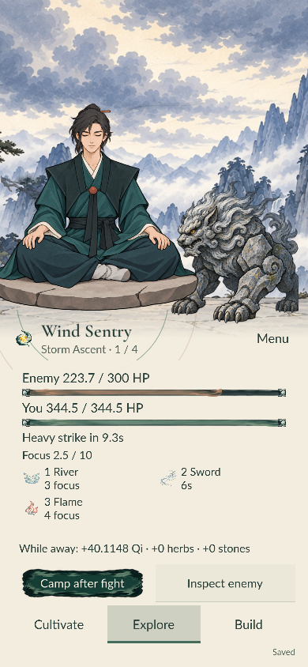
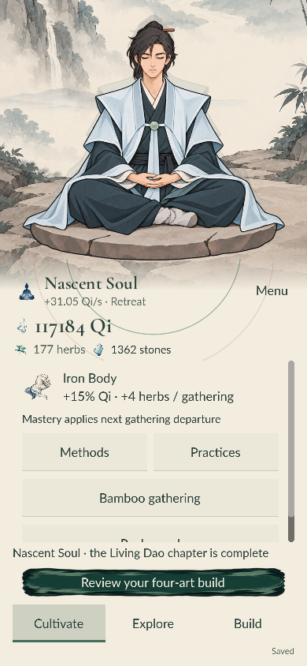

# Dao’s End — A Cultivator’s First Journey

Playable portrait-first cultivation game in Godot 4.7.2 / GDScript.
The **Living Dao** release candidate runs through **Nascent Soul**: twelve
finite routes across five regions, seven combat arts, fifteen equipment items,
three reversible laws and an earned fourth combat slot. Physical Android,
subjective audio listening and uncoached human testing remain release gates.

[Play in browser](https://medissl.github.io/daos-end/) ·
[Download Android ARM64](https://github.com/medissl/daos-end/releases/download/v0.4.0-rc.1/daos-end-living-dao-arm64.apk) ·
[Release notes](https://github.com/medissl/daos-end/releases/tag/v0.4.0-rc.1)

Actual exported-game screenshots:

<p> </p>

## Play

Open `project.godot` in Godot 4.7.2 and press **F5**. Default: 390 × 844;
desktop resizing puts the illustrated sanctuary beside the controls.

The browser build is ready in `builds/web/`. From the project directory:

```powershell
python -m http.server 8765 --bind 127.0.0.1 --directory builds/web
```

Open [the local game](http://127.0.0.1:8765/). WebAssembly and WebGL 2 are
required. Use one game tab at a time. Progress is local to the browser origin
and profile; clearing site data removes it.

Buy practices with Qi. Qi Refining reveals methods and Bamboo gathering.
The three destinations are **Cultivate**, **Explore** and **Build**. Foundation
opens the Jade Road and Build's Techniques / Equipment sections. Equip is
free; Improve and Refine are separate purchases. Discover Flame at the first
node and equip it directly at camp. Depart and Continue stay above navigation;
enemy inspection and inventories scroll separately. Explore recovers your
paused journey, and the realm checklist is a secondary view from Cultivate.
**Menu** contains sound, reduced animation, Help and Credits. Options do not
occupy gameplay controls. Phone navigation stays at the bottom; lists accept
finger swipes. Music starts off. Recorded wood/paper/water effects replace the
previous interface tones and bird ambience; sound choices persist in Menu.
Web/mobile layout uses logical screen dimensions so high-density displays
keep text and touch targets at the intended size.

The current implementation, comparable screenshots, motion and measured flows
are documented in [the Living Dao delivery](docs/living-dao/DELIVERY.md).
The [UX reset](docs/ux-reset/DELIVERY.md) remains historical evidence.

## Rules

- Start Mortal with 0 Qi and 1 Qi/second. Starter costs/effects/caps are unchanged.
- Qi = `(1 + breathing) × (1 + .25 × meridian) × realm × (1 + Azure bonus)`.
- Mortal advancement costs 1,200 Qi, or 800 after the 200-Qi Settle the Mind.
- Qi Refining doubles base production and freely reveals both techniques and
  Bamboo Forest. Neither technique equips automatically.
- Azure Cloud gives +20/30/40% Qi at mastery 0/1/2. Iron Body gives +2/4/6
  herbs per trip. Azure mastery costs 4 then 8 herbs; Iron costs 8 then 16.
- Forest trips take 120 seconds and give 4 base herbs. No entry price, chance
  of failure, rare drops or manual claims.
- A departure commits the method and both effective bonuses. Changes queue
  until the next departure; the realm’s base multiplier changes immediately.
- Foundation costs 10,000 Qi **and 12 herbs**. Optional preparation spends
  **12 additional herbs** to lower the Qi requirement to 7,000.
- Foundation multiplies base production by four and adds half the other
  method's bonus. Azure adds combat focus recovery; Iron adds combat HP.
- Foundation Retreat runs at 30% simulation speed, visible or closed. A finite
  authorized Journey runs at full speed in the foreground and stops at a camp
  or its end. No new frontier route starts automatically.
- Golden Core requires 24,000 Qi, three distinct finale seals, two route clears
  in each region and a separate Core Trial victory. Optional 24-herb preparation
  reduces incoming Core Trial damage by 10%. Golden Core has multiplier 8,
  three ordered combat slots and one free whole-build preset.
- Golden Core opens Thunder Peak, then Ancient Tomb and Moon Lake. Their six
  routes guarantee new arts and gear. Six inheritances teach protection,
  charged-hit interruption, barrier breaks and real cleansing.
- One inheritance in each new region plus all six new routes opens the
  three-stage Soul tribulation. Victory and 90,000 Qi unlock Nascent Soul,
  multiplier 12, four ordered arts and a persistent garment/pose change.
- One cleared route can be assigned for a finite supply run at 30% speed,
  identical open or closed. It is exclusive with a frontier journey and pauses
  Bamboo gathering. Only ordinary rewards repeat; no seals or first-clear loot.
- Discoveries and ordinary trial stages proceed automatically. Request Camp
  to stop at the next safe boundary. Build changes commit next encounter.
- Optional departure preparations are paid once on successful Depart. Selecting
  and cancelling costs nothing; free Equip never buys improvement/refinement.
- One clock advances Qi and expeditions together. Absence is capped at eight
  hours; it never starts an unauthorized trip or spends/advances for you.

Constants are in `scripts/progression.gd`; chapter definitions/rewards are in
`data/jade_road.json` and `data/living_dao.json`. Stored Qi keeps floating-point
precision; the large resource readout floors to whole Qi. Costs, herb totals
and effect values remain explicit.

## Saves

The application name and `user://cultivation.json` path are unchanged.
Native Windows: `%APPDATA%/Godot/app_userdata/Dao's End/`.
Web: Godot’s IndexedDB filesystem.

Schema **4** persists the `living-dao-v1` policy. Versions 1, 2 and 3 are
validated with frozen readers; legitimate prior absence uses its original
rules before migration. In-flight version-three encounters retain their old
resolver until the safe boundary. Each previously cleared old route receives
its newly introduced 2,400-Qi first-clear funding once. No new region clears,
gear, laws, supply assignments or preparations are invented. See the current
[event/migration contract](docs/living-dao/EVENT_ACCOUNTING.md) and historical
[migration details](docs/jade-road/SAVE_MIGRATION.md).

Primary, previous `.bak`, and interrupted `.tmp` snapshots remain recoverable.
Invalid/unsupported files are preserved as timestamped `.recovery-*` files
before replacement. If preservation fails, saving pauses. Recovery files are
not automatically deleted. Never manually overwrite a real player save for testing.

Purchases, choices, departures, mastery, preparation, advancement and lifecycle
changes save immediately; active play also saves every ten seconds. Browser
filesystem sync is asynchronous. Abrupt termination or unavailable storage can
lose recent work. No accounts, cloud sync or anti-cheat system are included.

## Verification

```powershell
python tools/prepare_verification.py
godot --headless --path . --script tests/run_tests.gd
godot --headless --path . --script tests/milestone_two.gd
godot --headless --path . --script tests/jade_road.gd
godot --headless --path . --script tests/living_phase_one.gd
godot --headless --path . --script tests/living_safety.gd
godot --headless --path . --script tests/living_rates.gd
godot --headless --path . --script tests/living_earned_jade.gd
godot --headless --path . --script tests/living_earned_soul.gd
godot --headless --path . --script tests/jade_audio.gd
godot --path . --script tests/verify_living_ui.gd
godot --path . --script tests/verify_living_frontier.gd
godot --path . --script tests/living_runtime_budget.gd
node tests/browser_living_dao.cjs --release
node tests/browser_living_frontier.cjs
```

Browser checks require Node.js, Playwright and Edge. Run the native UI check
first to refresh measured control coordinates, then re-export the browser
build. Tests use isolated save
paths/profiles and a temporary loopback server. The Living browser checks use
a Foundation-entry fixture and earned Golden Core/Soul checkpoints produced
by public progression scripts. Touch input and combat use the ordinary
browser clock. No clock is accelerated.

Older milestone-two UI/browser scripts are historical and have obsolete
Foundation-final layout assumptions. No verification controls or acceleration
ship in the game.

## Art, pacing and delivery

- [Current release candidate and evidence](docs/living-dao/DELIVERY.md)
- [Current pacing and limitations](docs/living-dao/PACING.md)
- [Before/after browser gallery](docs/living-dao/COMPARE.html)
- [Exact Living Dao content table](docs/living-dao/CONTENT_TABLE.md)
- [Historical Jade Road delivery](docs/jade-road/DELIVERY.md)
- [Generated art and visual review](docs/jade-road/ART_REVIEW.md)
- [Audio sources, licenses and edits](docs/jade-road/AUDIO_MANIFEST.json)
- [Historical milestone-two handoff](docs/MILESTONE_2_HANDOFF.md)
- [Rendered screenshots and verification](docs/art-direction/milestone-2/DELIVERY.md)
- [Interface finish and matched before/after screenshots](docs/art-direction/milestone-2/ui-finish/DELIVERY.md)
- [Strategy comparison](docs/design/MILESTONE_2_PACING.md)
- [Artwork and font provenance](assets/ART_SOURCES.md)
- [Engine and third-party licenses](THIRD_PARTY_NOTICES.md)
- [Icon asset manifest](assets/icons/manifest.json)

## Export

`export_presets.cfg` provides Web (single-threaded Compatibility) and Android
(ARM64) presets. Matching custom templates are in ignored
`.verification/templates/`; on another machine install Godot 4.7.2 templates
and clear or replace those local custom-template paths.

```powershell
godot --headless --path . --export-release Web builds/web/index.html
```

Android requires Java and the Android SDK. The local signed ARM64 APK uses the
existing `org.daosend.firstbreath` application ID. Signing keys and passwords
are private and excluded from Git. Retain the same key for later updates.
APK signature/package checks do not establish Android device performance;
physical-device installation and play remain pending.

The static ink-wash landing page is in `site/`. `python tools/package_site.py`
packages it with the exported game into `builds/site/` for GitHub Pages. The
user authorized GitHub publication and APK distribution after implementation.
No systems beyond Nascent Soul are included.
